# come-often

> 面向周边 3 公里熟客的私域复购小程序，把集章、积分、优惠券、订座与自提下单串成闭环。

## 📋 目录

- [项目简介](#项目简介)
- [界面预览](#界面预览)
- [技术栈](#技术栈)
- [项目结构](#项目结构)
- [环境要求](#环境要求)
- [快速开始](#快速开始)
- [配置说明](#配置说明)
- [部署指南](#部署指南)
- [常见问题](#常见问题)

## 项目简介

按 [docs/development-plan.md](docs/development-plan.md) 分阶段实施，单次交付、每阶段独立验收。M0~M11 全部完成，M12 登录体系、M13 首页改版与排队叫号已交付：骨架与环境、三端认证与权限、门店与菜品、购物车与自提订单（含 MQ 可靠性三件套）、支付与退款（Mock 网关与退款审核）、优惠券（动态券码与核销服务）、积分与等级（积分抵现与年度过期）、预约订座（时段容量与超时释放）、评价/搜索/首页运营、商家端小程序（统一扫码与订阅提醒降级）、数据看板与报表（Excel 导出）、联调与交付（`@JobLock` 兜底任务、死信告警可查、三条端到端脚本、四份交付文档）。M13 未完项（桌码服务端绑定、PC 后台排队页、实时叫号推送等）按 [docs/milestone-m14.md](docs/milestone-m14.md) 分六个批次补齐；B0 已收口 M13 交付欠账，B1 已落地 49 张表、30063~30099 业务码段与金额口径底座，B2 已接通叫号通知与顾客端 10 秒轮询、PC 后台排队页、桌码服务端绑定、营业状态前置校验、门店导航与后端 ZXing 二维码出图，B3 已落地储值充值与余额组合支付、会员价与等级折扣、券发放规则（新客 / 生日 / 复购 / 沉睡唤醒）与沉睡标签、积分兑换菜品，B4 已落地团购套餐、预售定时开售、指定包间、订单核销记录与评价审核。

十五份验收脚本 `deploy/verify-m1.ps1` ~ `verify-m11.ps1`、`deploy/verify-m13.ps1`、`deploy/verify-m14-b2.ps1` ~ `verify-m14-b4.ps1` 串行执行（B4 一次 109 条断言、0 失败），单测 227 个用例全绿。与开发计划的逐条差异见 [deploy/init.md](deploy/init.md)。

### 核心功能

- [x] 四个工程骨架与 JDK8 构建适配脚本
- [x] 统一响应、异常、日志与 Knife4j 在线文档
- [x] 49 张表 DDL（含 M13 排队号表与 M14 B1 储值 / 套餐 / 核销 6 张表）、M1 种子数据与中间件隔离初始化脚本
- [x] RabbitMQ 延迟/业务/死信拓扑、库存 Lua 与并发不超发验证
- [x] MinIO 后端转存、三端独立视觉 token
- [x] 三端登录与 RBAC：code2session、员工 BCrypt 登录、微信绑定与免密登录、三套 JWT、按权限渲染菜单与宫格（M1）
- [x] 门店/营业时间/桌台、6 分类 33 道菜、规格加料、每日售罄、预定菜规则、Banner/公告（M2）
- [x] 33 张菜品图处理管线（列表图 4:3 且 ≤80KB）、PC 后台 CRUD、顾客端分类页与详情页（M2）
- [x] 购物车、确认订单、订单状态机与 PICKUP / DINE_IN 双分支、订单日志、取餐码与到店核销码（M3）
- [x] 预定菜提前 24 小时、强制 DINE_IN、200 元定金整单抵扣的硬校验（M3）
- [x] MQ 可靠性三件套：本地消息表、未确认消息定时重发、死信落库告警；延迟消息超时取消并回补库存（M3）
- [x] PC 后台订单看板 / 消息可靠性面板，顾客端购物车、确认订单与订单分包页（M3）
- [x] PayGateway 抽象、Mock 支付回调与 `payment_record` 幂等、退款单与制作中审核态、PC 后台退款审核 Tab（M4）
- [x] 支付成功 `PAY_SUCCEEDED` 事件经本地消息表投递，供 M5/M6 消费（M4）
- [x] 5 类券模板、领券与后台定向发券、卡包三 Tab、30 秒时间窗动态券码（M5）
- [x] `CouponVerifyService` 单份核销规则、PC 输码/扫码枪核销台、核销记录与券 ROI（M5）
- [x] 线上下单券抵扣与取消退回、首单支付后自动发新人券、券过期提醒延迟消息（M5）
- [x] 积分账户与流水、签到 / 分享 / 完善资料发放、订单完成发积分（M6）
- [x] 积分抵现「下单冻结 → 支付成功实扣 → 取消/超时回滚」，每日 00:05 过期批处理（M6）
- [x] 会员等级按年度消费额与累计积分自动升级，PC 后台等级配置与会员积分查询（M6）
- [x] 预约时段库存预生成（capacity 由 store_table 聚合）、Redis Lua + DB 双层防超订（M7）
- [x] 预约创建 / 审核 / 取消（2 小时限制）/ 改期（双桶回补）/ 到店签到（R 前缀动态码）（M7）
- [x] 延迟消息触发超时 15 分钟 NO_SHOW 并回补容量、提前 1 小时提醒落库（M7）
- [x] PC 后台预约管理（日历视图 + 审核 + 桌台看板）、小程序门店列表 / 详情与预约链路（M7）
- [x] 一单一评 + 可选单道菜品、评价图上传落 `review_image`、评价发积分与重复提交拦截（M8）
- [x] 菜品评分聚合与评价分页、菜品详情页评价区、订单 `canReview` 入口（M8）
- [x] `DishSearchService` 右模糊搜索（菜名 / 副标题 / 描述 / 标签）与稳定排序，接口预留换 ES（M8）
- [x] 历史订单推荐（最近 3 单、去重、排除下架售罄、仅登录可见）与首页「最近吃过」横滑（M8）
- [x] 搜索页与菜品评价列表页、首页搜索入口；Banner 权重与时间窗验收（M8）
- [x] 商家端小程序 11 页：工作台、订单看板与详情、扫码、核销结果、核销记录、预约管理、桌台看板、菜品售罄、我的（M9）
- [x] `POST /api/merchant/scan/resolve` 统一扫码：券码 / 预约签到码 / 取餐码按码串分流，失败返回可展示原因枚举（M9）
- [x] 前台轮询 + 震动的新单提醒、商家端订阅消息埋点与模板缺失时的 `message_record` 降级（M9）
- [x] PC 后台经营看板：今日净营收 / 订单数 / 客单价、实时预约看板、今日热销 Top 5（M10）
- [x] 数据报表：营收与订单趋势（按日 / 周 / 月）、热销排行、券 ROI、复购率与次日留存、高价值用户（M10）
- [x] 四类报表 Excel 导出（EasyExcel 4.0.3，行数上限 300，超限返回 30056）（M10）
- [x] `@JobLock` 注解 + AOP 切面接管 11 个兜底任务，抢不到锁直接跳过（M11 起 7 个；M14 B2 过号、B3 沉睡打标 / 券规则、B4 预售上下架）
- [x] 补齐库存键按 DB 重建（每日 00:10）、订单自动完成、券过期小时级兜底（M11）
- [x] 通知与告警收口到 `NotifySender` 接口，死信与投递失败告警可经接口分页查询（M11）
- [x] 三条端到端脚本、RabbitMQ 停机恢复不丢消息、重投不重复发积分（M11）
- [x] 交付文档四件：README、部署说明、接口清单、Mock 能力替换清单（M11）
- [x] 首页改版：按星期营业时间、取号 / 预约入口、团餐券板块、领券中心、最近吃过（M13）
- [x] tabBar 改为首页 / 点餐 / 领券 / 我的；自提预约时间、购物车改为从下弹出的面板（M13）。堂食桌码经 `POST /api/app/store/table/bind` 服务端校验，下单携带 `tableId` 落 `trade_order.table_id`，下单成功后清空绑定（M14 B2）
- [x] 排队叫号：顾客取号 / 查号 / 取消、商家端叫号 / 入座（M13）。PC 后台 `/queue` 排队页已接入，叫号经 `NotifySender` 落 `message_record(QUEUE_CALL)`，顾客端前台每 10 秒轮询、离页停止，昨天的等待号由 `queue-expire` 过号任务收口（M14 B2）
- [x] 储值账户与流水、档位赠送充值、PC 后台储值管理；下单可用余额抵扣，取消 / 超时 / 退款分别写 `#ROLLBACK` / `#REFUND` 冲销（M14 B3）
- [x] 会员价菜品与等级折扣：会员价替换计价基数，折扣独立落 `trade_order.member_discount`，与不可叠加券同单时「券优先」（M14 B3）
- [x] 券发放规则（新客 / 生日 / 复购 / 沉睡唤醒）与 `user_coupon.grant_biz_id` 幂等键，沉睡标签每日刷新并支持后台按标签筛选（M14 B3）
- [x] 积分兑换菜品：整单用积分结算、下单即已支付，取消走 `#EXCHANGE_ROLLBACK` 退回积分（M14 B3）
- [x] 团购套餐：`group_bundle` + 明细独立商品，小程序展示 / 下单 / 商家扫码核销，PC 后台套餐管理；M13 三张团餐券保留为营销券（M14 B4）
- [x] 预售定时开售：开售 / 结束时间、独立预售库存、未开售 30081 / 已结束 30082 拦截、`presale-shelf` 每分钟自动上下架；与「提前 1 天预定的预定菜」互不相干（M14 B4）
- [x] 指定包间：`store_table.room_type` 三值，预约创建即锁 `reservation.table_id`，PC / 小程序可选具体包间（M14 B4）
- [x] 订单核销记录：`order_verify_record` 落核销人、渠道、码串、时间与 `#PICKUP` / `#BUNDLE` 幂等键，顾客端核销记录页；订单列表补四组状态 Tab 与触底分页（M14 B4）
- [x] 评价审核：`review.status` 三态 + PC 后台审核页，评分聚合只统计通过评价；先发后审默认通过，被拒绝的评价仍占「一单一评」（M14 B4）

## 界面预览

截图已统一规格：顾客端小程序 440×925（2 倍图，按 200 宽展示），PC 后台 1600×800，压缩版放在 `assets/screenshots/`。

**顾客端小程序**

<table>
  <tr>
    <td align="center">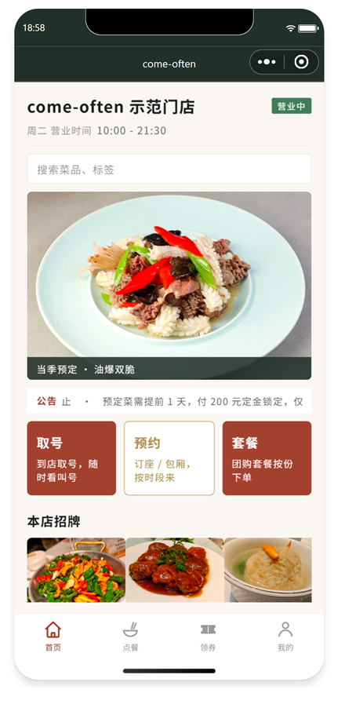<br>首页</td>
    <td align="center">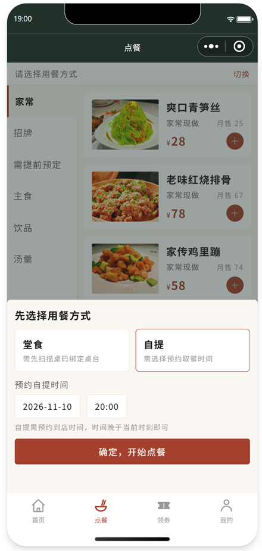<br>点餐</td>
    <td align="center">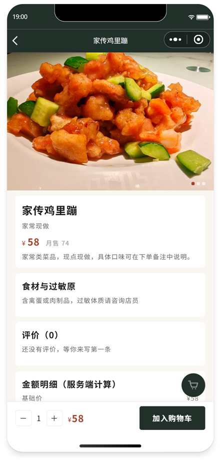<br>菜品详情</td>
    <td align="center">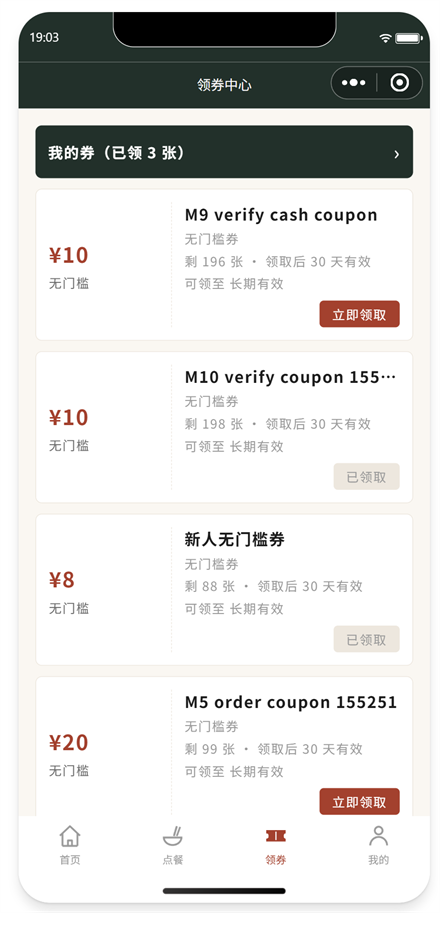<br>领券中心</td>
  </tr>
  <tr>
    <td align="center">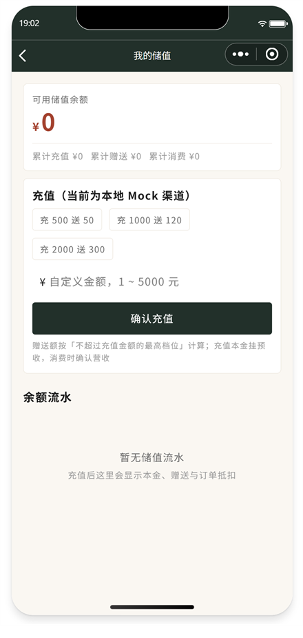<br>储值</td>
    <td align="center">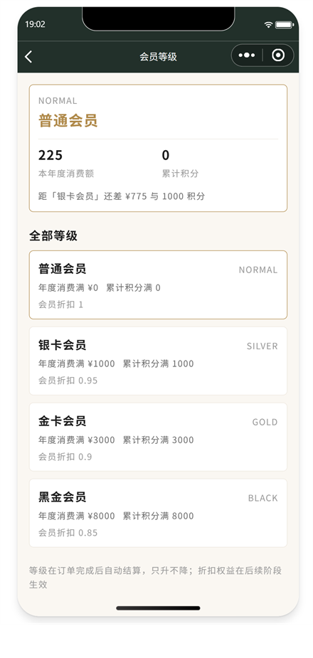<br>会员等级</td>
    <td align="center">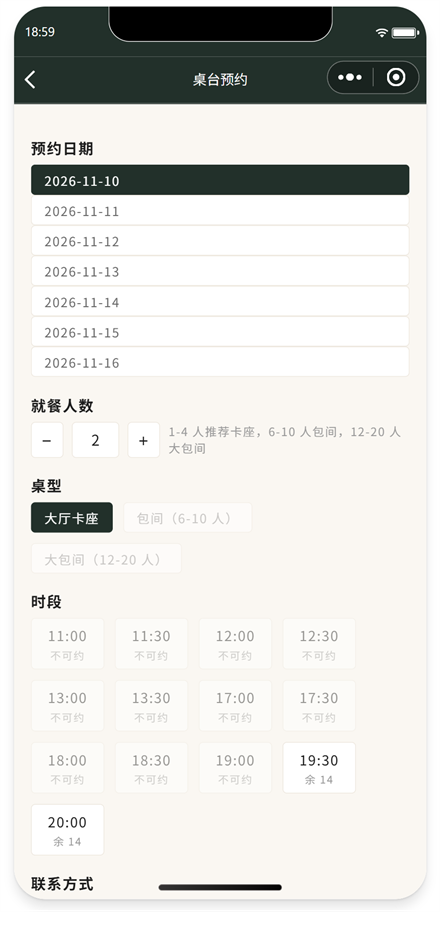<br>预约订座</td>
    <td align="center">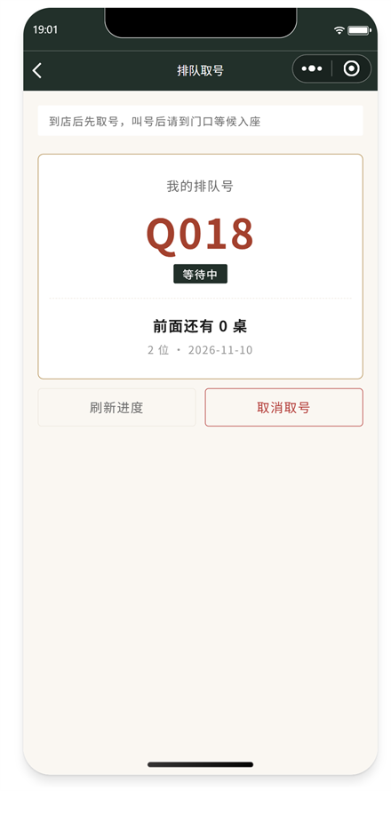<br>排队取号</td>
  </tr>
</table>

**PC 后台 / 商家后台**

<table>
  <tr>
    <td align="center">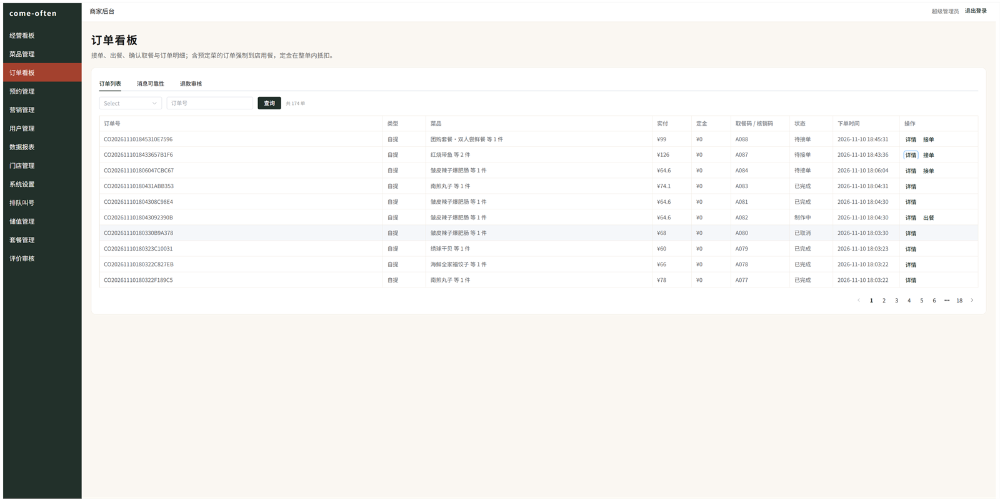<br>订单看板</td>
    <td align="center">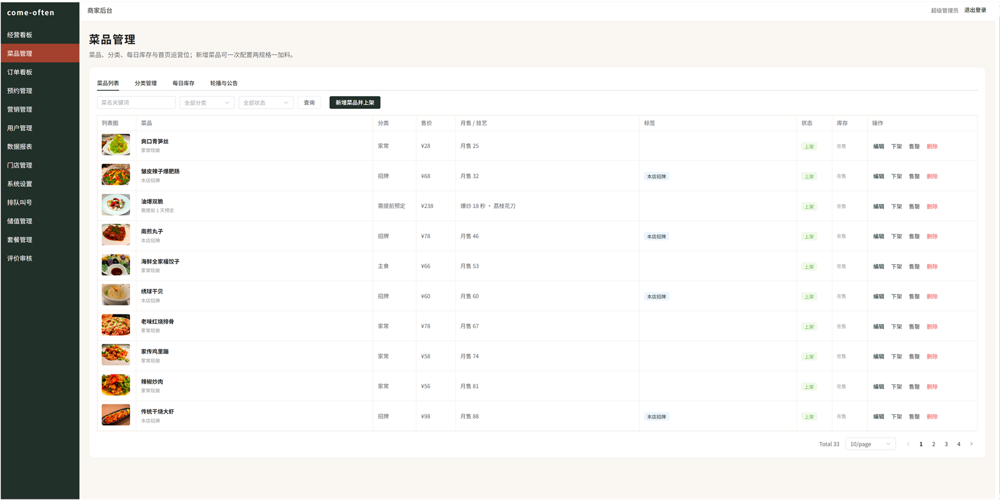<br>菜品管理</td>
  </tr>
  <tr>
    <td align="center">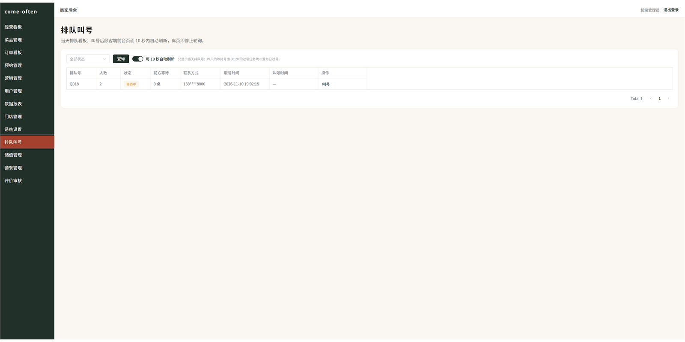<br>排队叫号</td>
    <td align="center">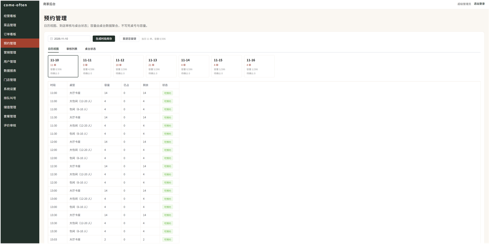<br>预约管理</td>
  </tr>
  <tr>
    <td align="center">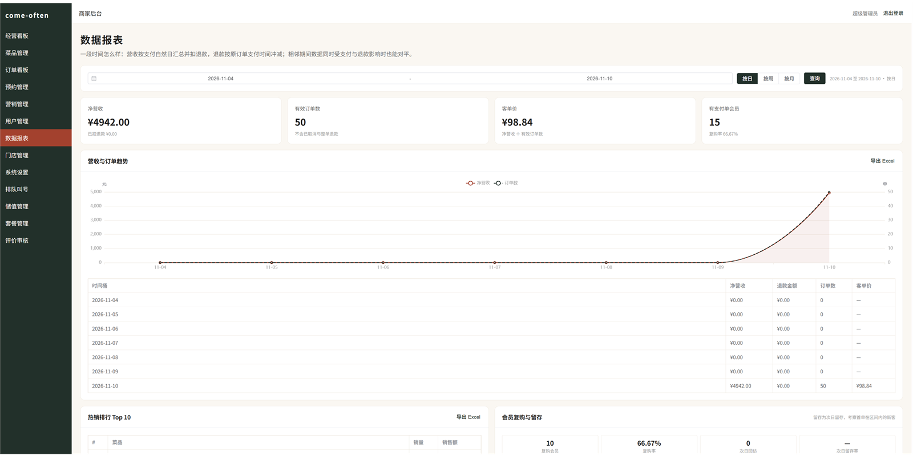<br>数据报表</td>
    <td align="center">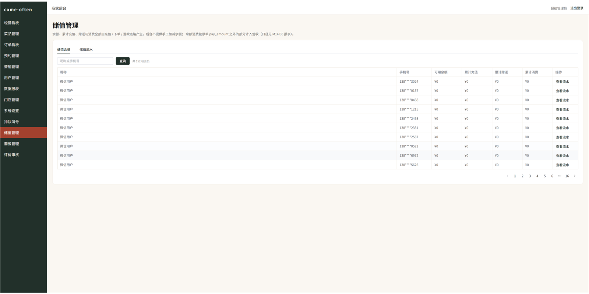<br>储值管理</td>
  </tr>
</table>

## 技术栈

| 分类 | 技术 | 版本 |
| --- | --- | --- |
| 后端 | JDK + Spring Boot | 1.8.0_431 + 2.7.18 |
| ORM | MyBatis-Plus | 3.5.3.2 |
| 数据库 | MySQL | 8.0.37 |
| 缓存 | Redis | 6.2.6 |
| 消息队列 | RabbitMQ | 3.8.19（含延迟消息插件） |
| 对象存储 | MinIO Java SDK | 8.5.7 |
| 接口文档 | Knife4j（OpenAPI3） | 4.5.0 |
| 构建工具 | Maven | 3.9.8 |
| 报表导出 | EasyExcel（自带 POI 5.2.5） | 4.0.3 |
| PC 后台 | Vue 3 + Vite 5 + TypeScript + Element Plus + Pinia + ECharts | 3.4.x / 5.4.x / 5.5.x / 2.8.x / 2.2.x / 5.5.x |
| 顾客端小程序 | 微信原生框架（WXML/WXSS/ES2020） | 最低基础库 2.11.1 |
| 商家端小程序 | 微信原生框架 | 最低基础库 2.11.1 |
| Node.js | 构建 PC 后台 | 22.22.2 |

## 项目结构

```text
d:\MyProducts\come-often\
├── .vscode/                  # IDE 配置，语言服务器 JDK 与项目编译 JDK 分离
├── deploy/                   # 中间件初始化、图片管线、M1～M10 验收脚本与说明
│   └── image-pipeline/       # 33 张菜品图裁切调色、SQL 生成、MinIO 上传
├── docs/                     # 文档统一目录：需求、开发计划、视觉基线、菜品素材、交付文档、数据库脚本
│   ├── db/                   # 数据库脚本：DDL、种子数据、增量迁移
│   │   ├── schema.sql        # 49 张表 DDL
│   │   ├── seed-m1.sql       # M1 账号、角色、菜单、权限点种子数据
│   │   ├── seed-m2.sql       # M2 分类、菜品、图片、库存、运营位、桌台种子数据
│   │   ├── migration-m13.sql # M13 增量迁移（排队号表 + 团餐券种子）
│   │   └── migration-m14.sql # M14 增量迁移（B1 的 6 张新表 + 加列 + 菜单权限点，末尾追加 B4 的 trade_order.bundle_id）
│   └── 菜品/                 # 菜品主数据 Excel 与图片素材
├── come-often-server/        # Spring Boot 后端（单 Maven 模块）
│   └── src/
│       ├── main/java/com/comeoften/
│       │   ├── common/       # 统一响应、错误码、全局异常；common/job 下是 @JobLock / JobResult / 切面
│       │   ├── config/       # MyBatis-Plus / Redis / RabbitMQ / MinIO / 通知通道 / Knife4j / 拦截器注册
│       │   ├── integration/  # 支付网关、微信 code2session、文件存储、通知通道（LOG + 订阅消息骨架）
│       │   ├── mq/           # 拓扑常量、生产者、发布确认、监听器、本地消息表、死信与告警
│       │   ├── job/          # 11 个兜底任务（MQ 重发 / 积分过期 / 预约未到店 / 时段滚动生成 / 库存重建 / 订单自动完成 / 券过期兜底 / 排队过号 / 沉睡打标 / 券发放规则 / 预售上下架）+ cron 接线 + 统一触发入口
│       │   ├── security/     # 三端 JWT、认证/权限拦截器、登录上下文
│       │   ├── module/       # auth / system / store / dish / home / cart / order / payment / coupon / points / reservation / review / stats / merchant / ops / balance / member / queue / bundle，域内按端拆 Controller
│       │   └── service/      # 跨域公共服务（库存等）
│       ├── main/resources/   # application*.yml、logback-spring.xml、lua/
│       └── test/             # 库存并发集成测试，状态机/金额/取餐码/SKU/券码/积分换算与等级判定纯逻辑测试
├── come-often-admin/         # Vue3 + Element Plus 商家 PC 后台
├── come-often-miniapp/       # 微信原生小程序（顾客端）
└── come-often-merchant/      # 微信原生小程序（商家端：工作台、订单看板、扫码核销、预约 / 桌台 / 售罄）
```

## 环境要求

- Windows 11，JDK 1.8.0_431（`C:\Program Files\jdk`），Maven 3.9.8
- Docker 27.1.1，已运行的 `mysql-8.0`、`redis-6.2.6`、`rabbitmq`、`minio` 四个容器
- RabbitMQ 已启用 `rabbitmq_delayed_message_exchange` 插件
- Node.js 22.22.2，微信开发者工具（开发期可用游客模式 `touristappid`）
- VSCode Java 扩展的语言服务器需 JDK 25，Spring Boot Tools 需 JDK 21，均已写入 `.vscode/settings.json`

## 快速开始

### 初始化中间件

只新建项目专用的 `come_often` / `come_often_test` 库、`/come-often` / `/come-often-test` vhost，不改动其他项目数据：

```powershell
.\deploy\init.cmd
```

`init.cmd` 共 8 步，第 5 步对两个库各导入一次 `docs/db/migration-m13.sql`（给 `queue_ticket` 补 `is_deleted`、播种 3 张团餐券模板），第 6 步再各导一次 `docs/db/migration-m14.sql`（M14 B1 的 6 张新表、既有表加列、4 个菜单权限点）。两份脚本用 `CREATE TABLE IF NOT EXISTS`、`INSERT IGNORE` 和加列前的 `information_schema` 判断，重复执行不会重复插入或报重复列。已建库的机器直接重跑 `.\deploy\init.cmd` 即可，**顺序必须是先迁移再启动后端**：旧库缺列时实体查询会报 `Unknown column`。

只在单独排查迁移脚本时才手工导入，两库都要执行：

```powershell
docker cp docs\db\migration-m13.sql mysql-8.0:/tmp/migration-m13.sql
docker exec mysql-8.0 sh -c "mysql -uroot -p123456 come_often < /tmp/migration-m13.sql"
docker exec mysql-8.0 sh -c "mysql -uroot -p123456 come_often_test < /tmp/migration-m13.sql"
docker cp docs\db\migration-m14.sql mysql-8.0:/tmp/migration-m14.sql
docker exec mysql-8.0 sh -c "mysql -uroot -p123456 come_often < /tmp/migration-m14.sql"
docker exec mysql-8.0 sh -c "mysql -uroot -p123456 come_often_test < /tmp/migration-m14.sql"
```

脚本说明与验证命令见 [deploy/init.md](deploy/init.md)。MinIO 私有桶由后端首次上传时自动创建。

`init.cmd` 会一并导入 `seed-m2.sql`（6 分类 33 道菜、99 条图片记录、当日库存、Banner/公告、营业时间与桌台）。这份 SQL 从 `docs/菜品/菜品.xlsx` 生成，改了 Excel 要先重新生成再初始化：

```powershell
python deploy\image-pipeline\generate_seed.py
python deploy\image-pipeline\process_images.py
```

`process_images.py` 产出 99 张 webp（列表 750×563、详情 750×500、缩略图 320×240）、`output/manifest.json`，以及 `output/preview/contact_sheet.jpg` 拼版。裁切和调色后要看一遍拼版：近方形原图裁成 4:3 会切掉上下约 9%，奶汤类白菜不能被暖调拉黄。管线依赖见 `deploy/image-pipeline/requirements.txt`。

### 后端启动

```powershell
.\build.cmd
.\run.cmd
```

`build.cmd` 只在当前进程内把 `JAVA_HOME` 指向 JDK 8，不改系统环境变量，执行时会打印 `mvn -v` 供核对。

### 初始账号

`.\deploy\init.cmd` 会一并导入 `seed-m1.sql`，三个初始账号密码均为 `Come@2026`：

| 账号 | 角色 |
| --- | --- |
| `admin` | 超级管理员 |
| `manager` | 店长 |
| `waiter` | 服务员 |

## 配置说明

| 配置项 | 说明 | 默认值 |
| --- | --- | --- |
| `spring.profiles.active` | 激活的 Profile | `dev` |
| `spring.datasource.url` | MySQL 连接 | `jdbc:mysql://127.0.0.1:3306/come_often` |
| `spring.redis.host` / `spring.redis.port` | Redis 连接 | `127.0.0.1` / `6379` |
| `spring.rabbitmq.virtual-host` | 项目专用 vhost | `/come-often` |
| `spring.rabbitmq.publisher-confirm-type` | 发布确认 | `correlated` |
| `spring.rabbitmq.listener.simple.acknowledge-mode` | 消费确认；`rabbitmq-reliability` 禁止 manual | `auto` |
| `spring.rabbitmq.listener.simple.retry.stateless` | 事务消费者每次重试开新事务 | `false` |
| `comeoften.order.pay-timeout-seconds` | 待支付超时秒数，下单发延迟消息；`ORDER_PAY_TIMEOUT_SECONDS` 覆盖 | `900` |
| `comeoften.mq.retry-interval-ms` | 未确认消息补偿扫描间隔（毫秒）；`MQ_RETRY_INTERVAL_MS` 覆盖 | `60000` |
| `comeoften.mq.pending-timeout-seconds` | PENDING 超过该秒数进入重发；`MQ_PENDING_TIMEOUT_SECONDS` 覆盖 | `60` |
| `comeoften.mq.max-retry` | 最大重发次数，超过转 FAILED + 告警；`MQ_MAX_RETRY` 覆盖 | `3` |
| `mybatis-plus.global-config.db-config.id-type` | 主键策略 | `ASSIGN_ID` |
| `comeoften.minio.*` | MinIO 端点、凭据、桶 | 见 `deploy/init.md` 环境变量表 |
| `comeoften.jwt.*-secret` / `*-ttl-seconds` | 三端独立 JWT 密钥与有效期（秒） | `86400` / `86400` / `7200` |
| `comeoften.wx.mock-enabled` | 是否走 Mock code2session，dev 无需 AppSecret | `true` |
| `comeoften.wx.appid` / `secret` | 真实小程序凭据，关闭 Mock 后必填 | `touristappid` / 空 |
| `comeoften.pay.gateway` | 支付网关；`mock` 本地默认，`wxpay` 需商户号（M4 只写骨架不启用） | `mock` |
| `comeoften.pay.wxpay.*` | 商户号、证书序列号、APIv3 密钥、私钥路径；由 `WXPAY_*` 环境变量注入 | 空 |
| `comeoften.coupon.code-secret` | 动态券码 HMAC-SHA256 密钥；`COUPON_CODE_SECRET` 覆盖，生产必须注入 | dev 内置长字符串 |
| `comeoften.coupon.expire-remind-ahead-hours` | 券过期提醒提前量（小时）；`COUPON_EXPIRE_REMIND_AHEAD_HOURS` 覆盖 | `24` |
| `comeoften.coupon.newcomer-template-id` / `newcomer-template-name` | 新人券模板：优先按 ID 匹配，留空按名称匹配发放中的同名模板 | 空 / `新人无门槛券` |
| `comeoften.points.order-earn-rate` | 每消费 1 元获得积分；`POINTS_ORDER_EARN_RATE` 覆盖 | `1` |
| `comeoften.points.exchange-rate` | 多少积分抵 1 元；抵现后订单至少保留 0.01 元；`POINTS_EXCHANGE_RATE` 覆盖 | `100` |
| `comeoften.points.sign-in-points` / `share-points` / `profile-points` / `review-points` | 签到、分享、完善资料、评价的发放额度；评价额度在 M8 生效，`biz_id` 为评价 ID | `5` / `5` / `20` / `10` |
| `comeoften.points.valid-days` | 积分有效期（天），写入 `points_record.expire_at`；`POINTS_VALID_DAYS` 覆盖 | `365` |
| `comeoften.points.expire-cron` / `expire-batch-size` | 每日过期批处理 cron 与单批条数；`@JobLock` 做单实例互斥 | `0 5 0 * * ?` / `200` |
| `comeoften.order.auto-complete-hours` / `auto-complete-batch-size` | `READY` 超过该小时数未取餐自动完成，单批条数；`ORDER_AUTO_COMPLETE_HOURS` 覆盖 | `24` / `200` |
| `comeoften.job.stock-rebuild-cron` | 三类库存键按 DB 重建的 cron | `0 10 0 * * ?` |
| `comeoften.job.order-auto-complete-cron` | 订单自动完成任务的 cron | `0 5 0 * * ?` |
| `comeoften.job.coupon-expire-cron` | 券过期提醒小时级兜底的 cron | `0 0 * * * ?` |
| `comeoften.job.presale-shelf-cron` | 预售到点自动上架 / 结束自动下架的 cron；只处理配了预售时间窗的菜品（M14 B4） | `0 * * * * ?` |
| `comeoften.coupon.expire-fallback-batch-size` | 券过期兜底的单批条数 | `200` |
| `comeoften.notify.channel` | 通知通道：`log` 落库 + 日志；`wx-subscribe` 为订阅消息骨架（同样降级落库）；`NOTIFY_CHANNEL` 覆盖 | `log` |
| `comeoften.notify.wx-subscribe-template-id` | 订阅消息模板 ID，只影响日志里的 `templateConfigured` | 空 |
| `comeoften.reservation.days-ahead` | 可预约未来天数（含当天），时段库存按 天数 × 时段 × 桌型 预生成；`RESERVATION_DAYS_AHEAD` 覆盖 | `7` |
| `comeoften.reservation.time-slots` | 开放预约的时段，逗号分隔 HH:mm；`RESERVATION_TIME_SLOTS` 覆盖 | `11:00`～`20:00` 共 13 个 |
| `comeoften.reservation.table-types` | 开放预约的桌型；`RESERVATION_TABLE_TYPES` 覆盖 | `HALL_CARD,PRIVATE_SMALL,PRIVATE_LARGE` |
| `comeoften.reservation.cancel-limit-hours` | 距预约不足该小时数不可取消，返回 30045 | `2` |
| `comeoften.reservation.no-show-minutes` | 预约时刻过后多少分钟未签到置 NO_SHOW，延迟消息按此投递 | `15` |
| `comeoften.reservation.remind-ahead-minutes` | 预约前多少分钟发提醒延迟消息 | `60` |
| `comeoften.reservation.auto-confirm` | 下单后是否自动确认；`false` 时停在 PENDING 等后台审核 | `true` |
| `comeoften.reservation.no-show-scan-cron` / `no-show-scan-batch-size` | 未到店兜底扫描 cron 与单批条数（实时仍走延迟消息） | `0 */5 * * * ?` / `200` |
| `comeoften.merchant.subscribe-template-id` | 商家端「新订单提醒」订阅消息模板；留空时降级为落 `message_record` + 日志 | 空 |
| `comeoften.stats.export-max-rows` | 报表 Excel 单次导出行数上限，超过返回 30056；`STATS_EXPORT_MAX_ROWS` 覆盖 | `300` |
| `comeoften.snowflake.worker-id` / `datacenter-id` | 多实例雪花节点号 | `0` / `0` |
| `spring.servlet.multipart.max-file-size` / `max-request-size` | 上传体积上限，容纳菜品原图 | `20MB` |
| `config/env.js` 的 `CURRENT_ENV` | 小程序接口环境 | `dev` |
| `config/env.js` 的 `FILE_BASE_URL` | 小程序图片只读地址 | `http://127.0.0.1:8080/api/public/file` |

凭据全部支持环境变量覆盖，生产环境不要沿用 dev 默认值。

## 部署指南

```powershell
cd come-often-server
mvn clean package -Dfile.encoding=UTF-8
java -Dfile.encoding=UTF-8 -jar target/come-often-server-0.0.1-SNAPSHOT.jar --spring.profiles.active=prod
```

运行日志在 `come-often-server/logs/app.log`，按时间与大小滚动。生产环境还需 HTTPS 与已备案域名、独立部署的中间件、微信支付 V3 证书与每日对账、短信与订阅消息资质，详见开发计划第十章。

中间件准备、环境变量清单、启动自检、日常运维（消息面板 / 兜底任务补跑 / 库存重建）、升级回滚与故障排查见 [docs/deployment.md](docs/deployment.md)。接口清单见 [docs/api-list.md](docs/api-list.md)，Mock 能力替换清单见 [docs/mock-replacement.md](docs/mock-replacement.md)；启动后可访问 `http://localhost:8080/doc.html` 查看 Knife4j 在线文档。

## 常见问题

**Q: 终端里 `mvn -v` 显示 JDK 25，会不会编译出错？**
A: 项目编译只看 `JAVA_HOME`。`build.cmd` / `run.cmd` 已固定为 `C:\Program Files\jdk`，实测输出 `Java version: 1.8.0_431`。`.vscode/settings.json` 里的 JDK 25 只给 Java 语言服务器用，二者是不同进程。

**Q: 启动日志报 RabbitMQ vhost 不存在，或连不上 `come_often` 库？**
A: 说明还没执行 `.\deploy\init.cmd`。该脚本只新建项目专用资源，可重复执行。

**Q: 直接把 `schema.sql` 通过 PowerShell 管道喂给 `mysql` 出现中文乱码？**
A: 用 `deploy\init.cmd`，它把文件 `docker cp` 进容器后用容器内重定向导入，绕开宿主终端编码。

**Q: 商家端小程序和顾客端能共用一个 AppID 吗？**
A: 开发期可以，openid 相同不影响功能验证。上线前商家端必须换成独立 AppID（企业主体，内部管理工具类目）。

**Q: 没有微信 AppSecret，M1 的登录怎么跑通？**
A: dev 默认 `comeoften.wx.mock-enabled=true`，走 `MockMiniAppClient`：小程序端持久化的 `mockKey` 映射成稳定 openid，同一设备多次 `wx.login` 仍是同一个用户。拿到真实 AppID/AppSecret 后把该开关设为 `false` 并配置 `WX_APPID` / `WX_APPSECRET`，改用 `WxJavaMiniAppClient` 调 code2session，业务代码不用改。

**Q: 清空 `wx_openid` 后，还没过期的商家端 token 为什么立刻失效？**
A: `MerchantAuthInterceptor` 每次请求都复核 `sys_user` 的状态与微信绑定，不依赖 JWT 自然过期；`TokenStoreService` 另用 Redis 存当前有效 jti，退出登录或后台删 key 也能立即踢登。

**Q: 小程序里菜品图为什么不显示？**
A: 图片走 `GET /api/public/file?objectKey=...` 匿名只读通道。`/api/public/**` 不在三端鉴权拦截器的注册范围内，但服务端只放行 `dish/`、`banner/`、`review/` 前缀并拒绝路径穿越。先执行 `python deploy\image-pipeline\upload_images.py` 把产物传进 MinIO 桶；换域名时改 `come-often-miniapp/config/env.js` 的 `fileBaseUrl`，DB 里的 objectKey 不用动。

**Q: 后台改了库存，顾客端多久生效？**
A: 立即。设置备货或一键售罄在 DB 事务提交后重置 `comeoften:dish:stock:{storeId}:{dishId}:{yyyyMMdd}`，key 带 48 小时 TTL；DB 的 `remain` 是最终事实源，下单前校验直接读 DB。每日 00:10 由 `stock-rebuild` 任务按 DB 把三类库存键（菜品余量 / 券模板余量 / 时段占用）全量拉回，Redis 重启或漂移最多影响一天；要立刻纠正可调 `POST /api/admin/job/stock-rebuild/run`。

**Q: 后台新建菜品时没填当日备货会怎样？**
A: 默认按 50 份初始化。M3 下单前若发现 Redis 库存键不存在，会按 DB 的 `remain` 重建（带 48 小时 TTL），不会误判售罄；没有当日库存记录的菜品按「不限量」处理，与 M2 的下单校验一致。

**Q: 含预定菜的订单，200 元定金到底怎么算？**
A: 定金 = `min(200, 整单金额)`，是整单金额的一部分，不额外加收。`payAmount` 仍是整单应付，小程序先付定金即转 PAID，尾款 `payAmount − depositAmount` 到店付。含预定菜的订单由服务端强制为 `DINE_IN`，到店时间必须晚于当前 24 小时。M4 起 `/pay` 走 `PayGateway` 预下单，Mock 回调入账只记已收的 200 元；退款时同样只退这 200 元，未收的 38 元尾款不退，且按计划 4.7 只能由商家后台主动发起（顾客端申请返回 30021）。

**Q: 待支付订单多久自动取消？验收脚本为什么几秒就能看到？**
A: 默认 900 秒，可用 `ORDER_PAY_TIMEOUT_SECONDS` 覆盖。延迟消息到点触发取消，同时回补 DB 与 Redis 库存。`verify-m3.ps1` 不改全局配置，而是调 `POST /api/admin/order/{orderNo}/resend-timeout?delaySeconds=3` 补发一条短延迟消息走同一消费链路；消费端按订单幂等，自动消息与补发消息不会重复回补。

**Q: 下单用积分抵现，钱从哪一步扣？订单超时或取消会退回来吗？**
A: 下单时写一条 `FREEZE` 流水并用带余额条件的 `UPDATE` 扣减 `points_account.balance`，同时落 `trade_order.points_amount / points_used` 快照；支付成功后这条流水 CAS 改成 `USE` 并累加 `total_used`，余额不再变动；取消或超时写一条 `ROLLBACK` 流水把积分加回余额。`balance = Σ change_amount` 恒成立，可直接对账。抵扣比例在 `comeoften.points.exchange-rate`（默认 100 分抵 1 元），且抵扣后订单至少保留 0.01 元，避免 0 元支付。

**Q: 等级什么时候变？为什么后台把门槛调高了会员等级没掉？**
A: 等级在「订单完成」消息的消费者里算，按本自然年已支付且未取消 / 未退款的实付总额与 `points_account.total_earned` 双条件判定，取同时达标的最高档。规则只升不降：降级会牵涉已发权益，计划未定义，所以调高门槛后已有等级不会回退。等级折扣率当前只作权益展示，未参与订单金额计算（见 `deploy/init.md` 差异 67）。

**Q: 手动重投同一条订单完成消息，会不会重复发积分？**
A: 不会。消费端先按 `messageId` 走 Redis 去重，最终判据是 `points_record.uk_points_idempotent(member_id, biz_type, biz_id)` 唯一索引，`biz_id` 为 `{orderNo}#EARN`。`verify-m6.ps1` 每次重投前会先删掉 Redis 幂等键，专门验证数据库这一层，重投 3 次流水仍是 1 条。

**Q: 小程序里预约时段全是空的怎么办？**
A: 时段是运行时数据，`init.cmd` 不会生成。现在由 `reservation-slot-generate` 兜底任务每日 00:00 按未来 N 天滚动预生成（cron 可用 `JOB_RESERVATION_SLOT_GENERATE_CRON` 覆盖），不需要人工点按钮。新增门店、调整桌型或任务漏跑时可手动补跑：`POST /api/admin/job/reservation-slot-generate/run`；只补单店用 PC 后台「预约管理 → 生成时段库存」（`POST /api/admin/reservation/slot/generate`）。生成走 `uk_slot` 幂等 upsert，重复执行不会重置已占用容量。

**Q: 并发抢同一个时段会不会超订？Redis 与 DB 不一致时以谁为准？**
A: 不会。Lua `tryOccupy` 先原子判 `booked + n <= capacity`，DB 再用 `booked + 1 <= capacity` 的条件更新兜底，任一失败立即回补 Redis 并返回 30041。DB 的 `reservation_slot.booked` 是最终事实源；Redis 键缺失（重启 / 过期）时会按 DB booked 重建，`POST /api/admin/reservation/slot/rebuild` 可全量对齐。

**Q: 预约改期后，旧的超时消息会不会把新预约置成未到店？**
A: 不会。延迟消息里带投递时的 `reserveAtMillis`，消费者比对当前预约时刻，不一致就直接丢弃；改期会同时投新的超时与提醒消息。延迟插件不支持撤回消息，所以靠这个字段而不是撤回。

**Q: 搜索为什么搜不到菜名中间的字？为什么不直接上 MySQL FULLTEXT？**
A: 按 `db-spec` 与已定口径，搜索只做右模糊（`LIKE 'kw%'`），命中菜名、副标题、描述与标签，禁止 `LIKE '%kw%'` 全模糊——那类查询用不上索引，数据量一大就拖垮库。所以输入「烧肉」搜不到「红烧肉」，要搜词中或词尾只能等换 Elasticsearch。查询条件全部收在 `DishSearchService` 实现里，Controller 与页面只依赖接口和 `PageResult<DishListVO>`，换实现时不动契约。

**Q: 评价图为什么只有 3 张？宽 320 是服务端裁的吗？**
A: 接口与页面都限制 3 张、单张 3MB。服务端**不做图片处理**，只校验 `review/` 前缀、图片类型与对象是否存在；端上先用 `wx.compressImage`（quality 80）压一次再 `wx.uploadFile`，所以桶里的图不一定精确 320 宽。要把压缩强制放到服务端，需另接图片处理管线，M8 刻意没做。

**Q: 商家端扫码要选「券核销」还是「签到」吗？三码怎么区分？**
A: 不用选。商家端只有一个扫码按钮，`POST /api/merchant/scan/resolve` 按码串分流：`C` + 6 位短序号 + 10 位签名是券码、`R` + 预约单号 + 10 位签名是签到码、`A001`~`D999` 是取餐 / 到店核销码。计划 3.12 写的 `P` 前缀没有采用——M3 已按 3.3 生成 `A###`（自提）与 `D###`（到店），再造一个 `P` 等于多一种不存在的码。失败也是 HTTP 200 + `success=false`，附 `failReason` 与可直接展示的文案。

**Q: 真机上商家扫顾客的券码扫不出来？**
A: 顾客端券码页目前只显示分组文本码，没有渲染二维码（M5 差异 52 留到 M9，M9 也未补：二维码需要二维码库或后端出图，属新增依赖）。验收走接口直传码串，PC 后台「核销台」手输仍是可用主路径。要给真机演示补二维码，加渲染即可，不用改后端接口。

**Q: 商家端退到后台后收不到新订单提醒？**
A: 订阅消息是**一次性订阅**，必须员工在点「接单」时授权一次；没有模板 ID 时后端只落 `message_record(MERCHANT_NEW_ORDER)` 并打日志（`comeoften.merchant.subscribe-template-id` 留空即此路径）。前台则靠 10 秒轮询 + 震动 + 顶部提示条，退到后台只能靠订阅消息，这是平台硬约束，M11 再接真实发送。

**Q: 兜底任务会不会在两个实例上同时跑？停掉 RabbitMQ 期间下的单会丢吗？**
A: 都不会。任务方法标 `@JobLock`，锁是 Redis `SETNX + TTL`（键 `comeoften:job:lock:{任务名}`），抢不到锁**直接跳过**、不排队；cron 与手动补跑共用同一把锁，并发触发时只有一个真正执行（单测 `JobLockAspectIntegrationTest` 用 8 路并发验证）。Redis 整个不可用时按 fail-open 处理——任务照常执行，因为它们都按 DB 条件幂等（状态 CAS、唯一索引、比对后写入），一次缓存抖动不该让兜底能力整体停摆。

MQ 停机期间下单：业务事务照常提交，本地消息表里的记录停在 `PENDING`（付款接口也不会失败），`publisher-returns` / confirm 拿不到确认就交给每分钟的补偿任务；broker 恢复后重发至 `SENT`。`verify-m11.ps1` 用真实的 `docker stop/start rabbitmq` 跑这条链路：停机期间 4 条消息全 `PENDING` 且业务成功，恢复后全部 `SENT`、无 `FAILED`/`DEAD`。

**Q: 死信和投递失败的告警在哪儿看？**
A: 落 `message_record(MQ_ALARM)`，`GET /api/admin/mq/message/alarm`（`order:manage`）分页查，只暴露告警类型；消息本身的状态在 `GET /api/admin/mq/message?status=DEAD|FAILED`，可对 `messageId` 人工重放。M11 修了两个会让告警失真的问题：死信消费者此前用的是 JSON 容器工厂，无法反序列化的毒消息在调用监听器之前就抛异常，告警根本没落库；延迟交换机在消息到期前的 returned 回调（replyCode 312）被当成投递失败，导致每条延迟消息都多一条假 FAILED。现在死信走 `SimpleMessageConverter` 原始字节通道，延迟消息的 returned 只记 warn、不改状态（差异 155、157、171）。

**Q: 报表净营收和 M6 的年度消费额、M9 工作台的今日营收为什么对不上？**
A: 三套口径是刻意分开的。报表现行口径是**净额**（已支付 − 已退款，退款按原订单 `paid_time` 冲减），M6 年度消费额与 M9 工作台营收仍按 `pay_amount` 全额汇总、不扣部分退款（见 `deploy/init.md` 差异 67 与 M6 已知局限）。改动营收口径会牵动等级判定与已经验收的商家端数字，所以只在报表侧收敛。

**Q: 为什么报表按 `paid_time` 的自然日分桶，而不是取餐码用的 `biz_date`？**
A: 取餐码的 `biz_date` 是**营业日**，用来保证「同店同营业日取餐码不重复」，跨零点仍算前一天的生意；报表是**资金口径**，一笔 23:59 支付的单应该记在支付当天，否则跨零点当天的营收会忽然变负。两者服务不同目的，刻意不统一，差异见 `deploy/init.md` 第 138 条。
